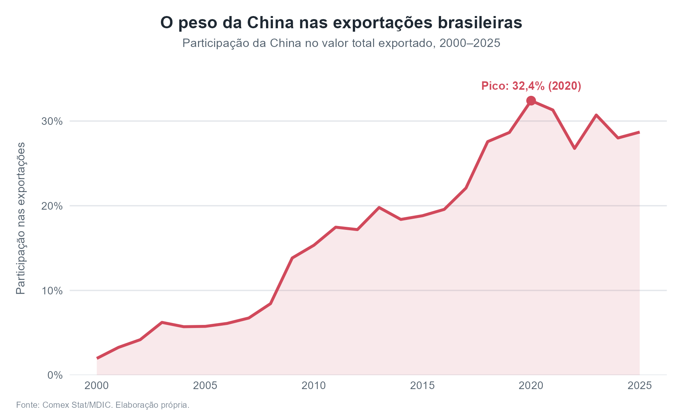
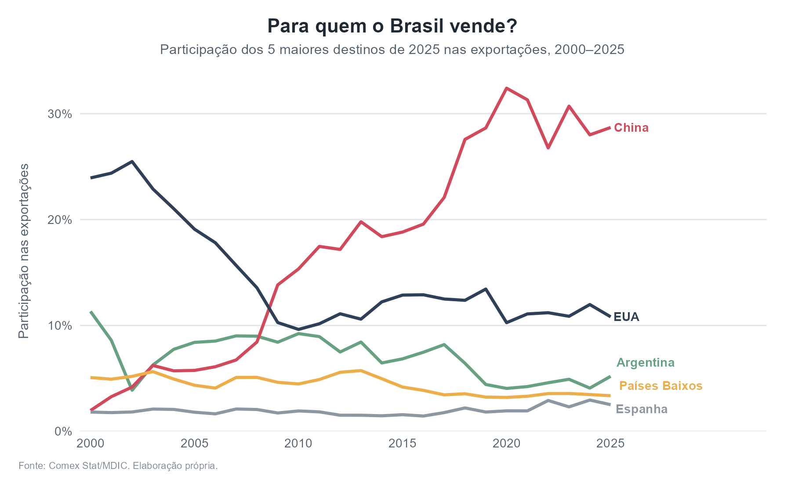
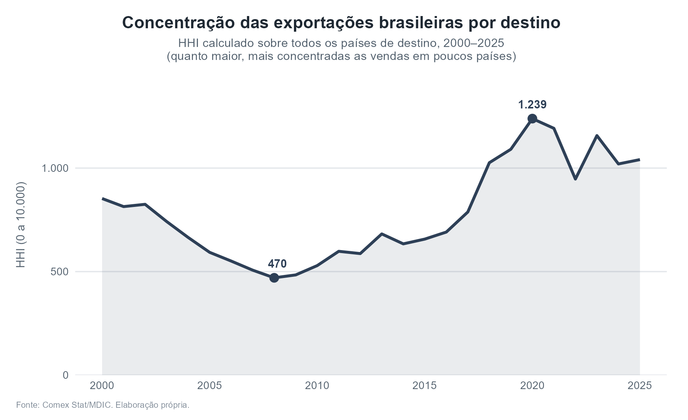

# O quanto o Brasil depende da China?

Análise da evolução e da concentração das exportações brasileiras por país de destino, entre 2000 e 2025, feita em R com dados oficiais do Comex Stat.

## Pergunta
A participação da China nas exportações brasileiras cresceu? O Brasil está mais ou menos concentrado em poucos compradores do que há 25 anos?

## Dados
Comex Stat (Ministério do Desenvolvimento, Indústria, Comércio e Serviços), obtidos pela API oficial com o pacote `comexr` do R. Valores em US$ FOB, agregados por país de destino e por ano.

## Principais resultados
- A participação da China nas exportações brasileiras subiu de 2% (2000) para 28,7% (2025), com pico de 32,4% em 2020.
- A China ultrapassou os EUA como principal destino por volta de 2009. Em 2000, os EUA recebiam quase 24% das exportações; em 2025, 10,8%.
- O índice de concentração (HHI) por destino caiu até 2008 (470) e depois mais que dobrou, chegando a 1.239 em 2020. Em 2025, é de 1.041.

## O que é o índice Herfindahl-Hirschman (HHI)
O HHI mede o quanto as exportações estão concentradas em poucos compradores. O cálculo tem três passos:
1. Para cada país de destino, calcula-se sua participação (share) no total exportado.
2. Cada participação é elevada ao quadrado.
3. Somam-se os quadrados e multiplica-se por 10.000.

Exemplos simples: se o Brasil vendesse tudo para um único país, o HHI seria 10.000. Com dois compradores de 50% cada, seria 5.000; com quatro de 25%, 2.500; com dez de 10%, 1.000.

Uma forma intuitiva de ler o índice: 10.000 dividido pelo HHI dá o número de "compradores equivalentes" de mesmo tamanho. Em 2008 (HHI = 470), isso equivale a cerca de 21 compradores; em 2025 (HHI = 1.041), a cerca de 10.

O HHI é calculado com **todos** os países de destino, e não só com a China. Mas, como as participações são elevadas ao quadrado, o índice dá muito peso aos maiores compradores. Em 2025, a China (28,7%) responde por cerca de 80% do valor do índice.

## Limitações
- Os dados mostram o destino declarado, não o destino final (por exemplo, parte do que vai para os Países Baixos segue para outros países europeus).
- A análise é feita pelo valor total, sem separar por produto.
- Não há um valor "certo" de HHI para o comércio exterior. Os limites usados em defesa da concorrência foram criados para mercados de empresas e variam entre países e ao longo do tempo, então servem só como referência. O mais informativo é a tendência ao longo do tempo.

## Como reproduzir
1. Abra o projeto `exportacoes_brasil_china.Rproj` no RStudio.
2. Rode `scripts/01_baixar_dados.R` (coleta pela API; leva alguns minutos e está sujeita a limites de requisições).
3. Rode `scripts/02_analise.R` (cálculos e gráficos).

Pacotes utilizados: `comexr`, `dplyr`, `ggplot2`, `scales`.

## Estrutura do repositório
- `dados/`: dados baixados do Comex Stat e tabelas finais (participação por país e ano, HHI).
- `scripts/`: códigos em R (coleta e análise).
- `graficos/`: imagens geradas pela análise.